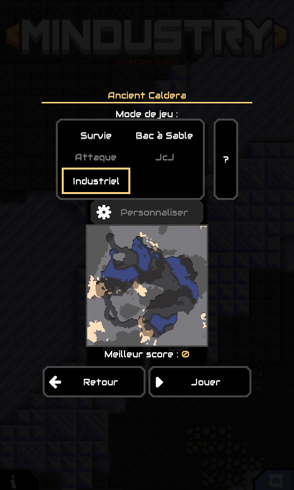
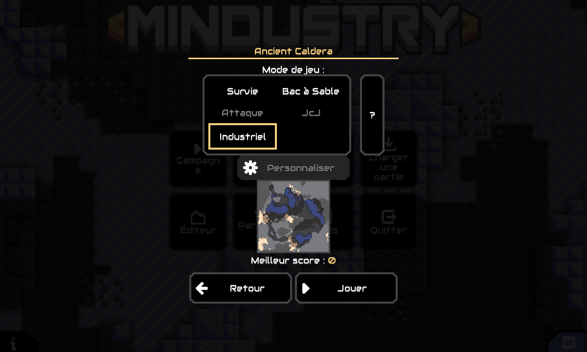
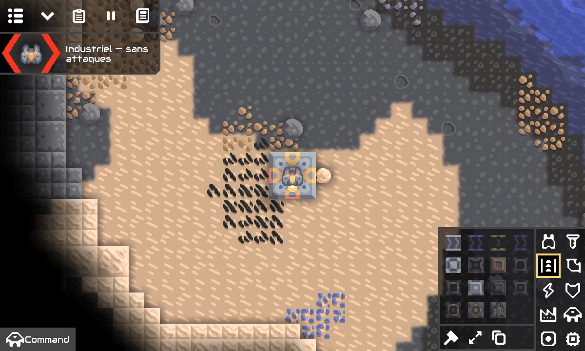

# Mission 3 — premier mode Industriel

Le mode **Industriel** est ajouté aux parties personnalisées, avec ressources de départ limitées, coûts de construction normaux et simulation industrielle d’origine. Les autres modes et la campagne sont conservés.

## Installer et jouer sur Android

- APK validé : [télécharger le ZIP APK et sources](https://github.com/Ankool29/Mindustry-Industrial/actions/runs/41888638797/artifacts/13353056101)
- Exécution GitHub Actions : [41888638797 — succès](https://github.com/Ankool29/Mindustry-Industrial/actions/runs/41888638797)
- Sources compilées : [1219f5594294adc974003943f83fc8ab494b5552](https://github.com/Ankool29/Mindustry-Industrial/tree/1219f5594294adc974003943f83fc8ab494b5552)

Télécharger l’artefact **Mindustry-Industrial-Android**, extraire le ZIP dans **Mes fichiers**, puis ouvrir **Mindustry-Industrial-v160.7-m3.apk**. L’application s’appelle **Mindustry Industrial M3**.

Dans le jeu : **Partie personnalisée → choisir une carte → Industriel → Jouer**. La carte **Ancient Caldera**, déjà fournie par Mindustry, a été utilisée pour le contrôle visuel. Le panneau peut défiler sur les petits écrans. En partie, le statut **Industriel — sans attaques** confirme le mode.

**Conserver l’ancienne application de Mission 2 et ses sauvegardes.** La clé de test de cette ancienne version n’avait pas été conservée par son cache ; une mise à jour compatible avec sa signature n’est pas possible. M3 s’installe donc séparément avec l’identifiant `io.anuke.mindustry.industrial.m3`, sans désinstallation ni modification des données de Mission 2 ou du jeu officiel. Pour transférer les sauvegardes, utiliser l’export des données dans les paramètres de l’ancienne application, puis l’import dans M3.

## Comportement du mode

- Vagues automatiques et manuelles désactivées, sans condition militaire de victoire ou de défaite ni limite de temps.
- Bases et unités ennemies retirées du monde chargé ; rejets des unités ennemies différées avant leur simulation. Les ruines neutres, déjà inactives dans le moteur original, sont conservées.
- Objectifs de carte et texte de mission retirés ; processeurs de monde désactivés pour éviter les scripts réintroduisant du combat. Les processeurs logiques ordinaires restent disponibles.
- Pas de ressources infinies de construction, de construction instantanée, de remplissage automatique des noyaux ni de consommation gratuite des machines.
- Foreuses, convoyeurs, recettes, intrants, énergie, liquides et stockage utilisent les systèmes existants. Les stocks de départ restent ceux de la carte.
- Le fichier de carte original n’est jamais réécrit. Ce mode s’applique aux parties personnalisées, pas aux secteurs de campagne.

Le réglage Industriel est réappliqué après les règles de carte et la restauration du contenu. Le bouton de personnalisation des règles est désactivé pour ce mode, afin de préserver ses garanties de départ.

## Architecture et compatibilité

`IndustrialMode` centralise la politique du mode, séparément des machines et des générateurs de secteurs. Un indicateur `Rules.industrial` est enregistré dans la sauvegarde. Il vaut `false` lorsqu’il est absent d’une ancienne partie : aucune conversion automatique des sauvegardes précédentes. Le nouveau mode est ajouté à la fin de l’enum ; les identifiants numériques des anciens modes restent inchangés. Aucun nouveau format binaire de sauvegarde n’est introduit.

Cette séparation prépare les futures politiques de recherche et de gisements, sans les implémenter maintenant. Les gisements gardent leur extraction infinie d’origine ; l’arbre technologique progressif, les ressources épuisables, les nouveaux secteurs et les nouvelles recettes restent hors de cette mission.

## Tests réalisés

La suite GitHub Actions contient **343 tests : zéro échec et zéro erreur**, dont **8 scénarios industriels** :

1. Mode visible, traductions française/anglaise et identifiants des anciens modes conservés.
2. Règles hostiles d’une carte neutralisées, y compris les objectifs restaurés après chargement ; fichier source inchangé.
3. Unités, noyau et tourelle ennemis retirés ; vagues manuelles et apparitions différées bloquées ; unité de construction alliée conservée.
4. Minerai extrait par une foreuse mécanique et transporté jusqu’au stockage par des convoyeurs.
5. Fonderie de silicium alimentée par un générateur à combustion : consommation des intrants, production réelle et arrêt sans courant.
6. Coût réel d’un convoyeur débité au noyau ; chantier bloqué quand le stock est vide.
7. Sauvegarde/reprise du mode industriel avec conservation de l’inventaire de machine.
8. Chargement d’une ancienne sauvegarde, comportement des modes d’origine et fonctionnement normal des vagues hors mode industriel.

Les tests amont de logique, énergie, contenu et sauvegardes sont également exécutés. Les rapports JUnit et HTML sont disponibles dans l’artefact **Gameplay-test-reports**. La CI compile ensuite les sprites et l’APK, vérifie sa signature, son identifiant, ses bibliothèques ARM64, les atlas et l’alignement ZIP 16 Kio.

Le client graphique a aussi été démarré dans le cloud avec `-testMobile`. Le bouton Industriel a été sélectionné, le menu contrôlé en portrait et en paysage, puis **Jouer** a lancé une partie Industriel avec ressources de construction limitées et vagues désactivées. [Script de contrôle local](docs/mission3/ui-check.js), non inclus dans l’APK.

Il s’agit d’un contrôle graphique du client en disposition mobile, pas d’un essai du nouvel APK sur un S25 Ultra physique. Le précédent APK a été confirmé installé et lancé sur ce téléphone par son utilisateur ; l’installation de M3 reste à confirmer.

## Signature, sources et limites

La chaîne conserve Java 17, Gradle 8.14.3, AGP 8.10.1, Android SDK 36 et Build Tools 36.0.0. La signature M3 est une signature de test avec un chemin explicitement partagé entre Gradle et le cache GitHub. Les sources correspondantes, la GPL et la licence Apache d’Arc sont jointes à l’artefact.

Empreinte du certificat final : `61254fd2280bf34aa64bd06405cf0e2bc9b2d8fe7df4cc615c39983bcdfd8086`

Le cache reste un stockage temporaire et ne remplace pas une clé de publication durable dans GitHub Secrets. Les mods modifiant le moteur et le multijoueur entre versions différentes ne sont pas couverts par cette validation. Les artefacts sont conservés 30 jours.

La restauration de cette même clé a été vérifiée par une seconde compilation réussie sur la branche de travail : [41889283355](https://github.com/Ankool29/Mindustry-Industrial/actions/runs/41889283355). Le certificat obtenu est identique.

SHA-256 de l’APK livré, vérifié après téléchargement : `0b82a03993ec71a9ea667a3c9356d332cbd417c329779c302e8e80ff1cfdc84e`.
