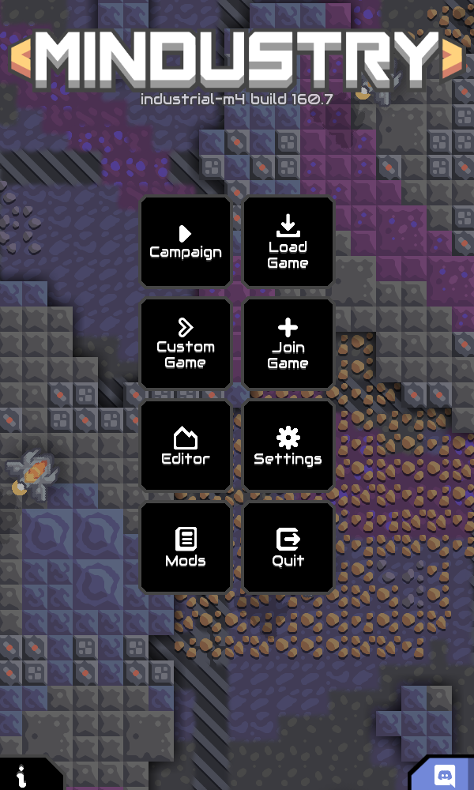
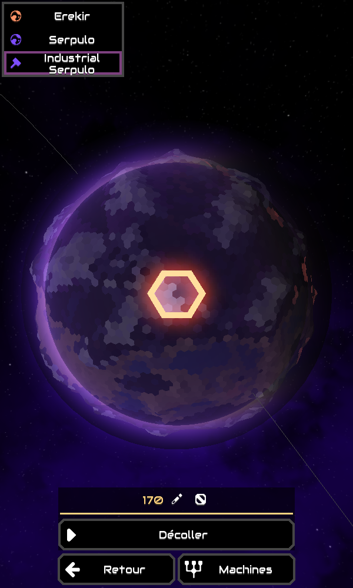
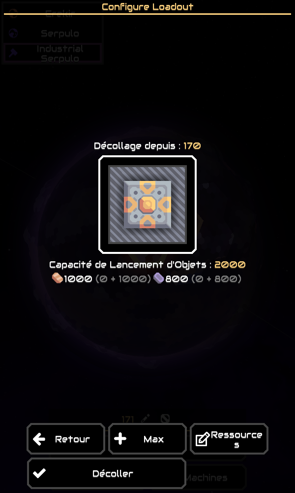
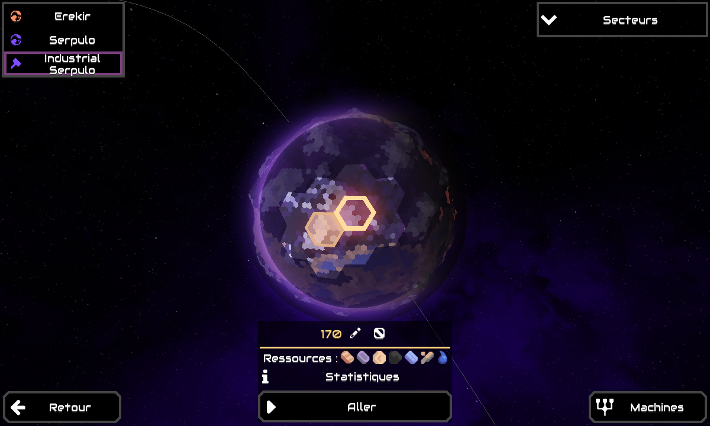
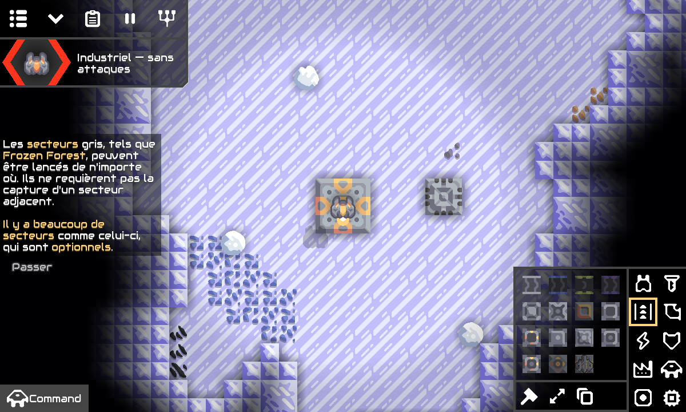

# Mission 4 — campagne planétaire industrielle

Une nouvelle planète **Serpulo industrielle** permet de développer plusieurs secteurs sans ennemis, vagues, invasions ni objectif militaire. Les campagnes classiques et le mode Industriel sur carte personnalisée restent disponibles.

## Jouer depuis Android

- **[Télécharger l’APK M4 et ses sources](https://github.com/Ankool29/Mindustry-Industrial/actions/runs/41896356479/artifacts/13357580159)**
- [Compilation GitHub Actions réussie — 41896356479](https://github.com/Ankool29/Mindustry-Industrial/actions/runs/41896356479)
- [Sources exactes — 258082a01eaccebba67a2a337d04aa1c5e31313d](https://github.com/Ankool29/Mindustry-Industrial/tree/258082a01eaccebba67a2a337d04aa1c5e31313d)

Extraire le ZIP dans **Mes fichiers**, puis ouvrir `Mindustry-Industrial-v160.7-m4.apk`. Installer par-dessus M3, **sans désinstallation**. L’identifiant `io.anuke.mindustry.industrial.m3` est conservé ; le code de version Android passe à **4**. Les anciens secteurs et parties personnalisées gardent leur mode et leurs fichiers. Exporter les données avant une mise à jour de test reste recommandé.

Dans **Jouer → Campagne**, choisir **Campagne industrielle** au premier lancement, ou sélectionner **Serpulo industrielle** dans la liste des planètes si une campagne existe déjà. Le secteur initial est le **170**. Il reçoit le stock normal de **100 cuivre**, sans ressource de construction infinie. Produire ensuite les matériaux requis pour le chargement de déploiement d’origine, sélectionner un secteur adjacent sur la carte planétaire et lancer le départ. Revenir aux bases déjà établies pour continuer leurs usines.

Les campagnes classiques demeurent accessibles par la même carte planétaire. M4 ne convertit aucune sauvegarde existante.

## Modifications et architecture

- `IndustrialPlanet` applique les règles pacifiques à une planète dédiée, y compris après les réglages de campagne, la génération et le chargement des sauvegardes. Les réglages d’invasion et les IA de campagne ne peuvent pas réactiver les attaques sur cette planète.
- `IndustrialCampaign` délimite la campagne active, les informations pacifiques de secteur, l’exploration des voisins, la sélection de la base de départ et le stock initial limité. Les gardes existantes d’`IndustrialMode` couvrent désormais cette campagne isolée.
- La nouvelle planète utilise `SerpuloPlanetGenerator`, la grille, la graine et les mécanismes existants. Aucun algorithme de génération ni fichier de machine/recette n’est modifié. Les points d’apparition et entités hostiles sont retirés du monde chargé, sans modifier une carte source.
- Les fichiers `sector-industrial-serpulo-<id>.msav`, les informations de secteur et les statistiques de cette planète ont leur propre espace de noms. L’entrée de contenu est ajoutée après les planètes existantes ; leurs identités ne sont pas décalées. Aucun nouveau format binaire de sauvegarde n’est introduit.
- La sélection des voisins ne dépend plus d’une victoire ou d’un noyau militaire supérieur dans cette seule campagne. L’interface de chargement, les exigences du schéma, le débit des ressources et les transitions restent ceux de Mindustry.
- Les machines Serpulo sont disponibles ici au coût normal, sans écrire les déblocages globaux de la recherche classique. L’interface **Machines** explique l’absence provisoire d’arbre industriel. La recherche classique s’utilise après retour dans une campagne classique.
- L’interface de sélection initiale peut défiler en portrait. L’accès à la planète réutilise le menu de campagne et la carte planétaire existants.

## Tests et compilation

Les cinq nouveaux scénarios automatisés couvrent :

1. Planète séparée, générateur et grille d’origine réutilisés, espace de sauvegarde distinct et absence de bases ennemies.
2. Génération du premier secteur avec 100 cuivre, coûts normaux, aucune vague, apparition ennemie ou fin militaire ; secteur voisin accessible après établissement de la base.
3. Machines industrielles disponibles sans mutation des déblocages persistants de la recherche classique ; comportement classique restauré hors de cette campagne.
4. Deux secteurs générés et sauvegardés, coût de schéma réellement débité, aucun second stock de départ gratuit, chargement des deux fichiers avec stocks et bâtiment conservés.
5. Réactivation d’invasions/IA par des paramètres hostiles neutralisée sur la nouvelle planète, réglages de Serpulo classique conservés.

Les huit scénarios M3 restent exécutés : extraction, convoyeurs, production alimentée en énergie, arrêt sans courant, coûts de construction, sauvegardes, anciennes parties et modes classiques. Les autres tests amont de logique, contenu, énergie et sauvegardes restent inclus.

**348 tests, aucun échec, aucune erreur, aucun test ignoré**, dans le cloud et dans GitHub Actions. Le rapport JUnit téléchargé depuis [Gameplay-test-reports](https://github.com/Ankool29/Mindustry-Industrial/actions/runs/41896356479/artifacts/13355344538) confirme ce total. Les [preuves Android](https://github.com/Ankool29/Mindustry-Industrial/actions/runs/41896356479/artifacts/13357016202) contiennent versions, compilation, signature et contrôles d’APK.

Le client graphique a été lancé dans le cloud avec `-testMobile`, en portrait 600×1000 puis paysage 1200×720. Le [script de contrôle](docs/mission4/ui-check.js), absent de l’APK, a sélectionné **Campagne industrielle** dans le véritable sélecteur initial, lancé le secteur 170 par son bouton, vérifié les 100 cuivre et les règles pacifiques, ouvert la planète puis le voisin 171, confirmé le déploiement dans l’interface d’origine et rejoint ce deuxième secteur. Il est ensuite revenu au secteur 170 : la presse construite était conservée et le noyau contenait 500 cuivre après débit des 1000 cuivre du schéma. Le banc de test avait fourni les matériaux nécessaires au voyage ; le jeu ne les offre pas.

La CI a construit les atlas, assemblé l’APK Android, vérifié la signature, l’identifiant, les bibliothèques ARM64, les sprites et l’alignement ZIP 16 Kio, puis publié l’artefact. Le certificat attendu est celui de M3 : `61254fd2280bf34aa64bd06405cf0e2bc9b2d8fe7df4cc615c39983bcdfd8086`.

## Limites restantes

L’arbre technologique industriel progressif, les gisements épuisables, les fusées personnalisées, le carburant, les nouvelles machines et recettes restent hors de cette mission. Les armes existantes restent disponibles mais ne sont pas nécessaires. Les gisements utilisent l’extraction infinie d’origine.

La production hors écran conserve les estimations statistiques de Mindustry ; aucune nouvelle économie intersectorielle n’est simulée. Les chargements de déploiement et les éventuels bâtiments logistiques d’origine restent ceux du jeu. Un secteur voisin exige les ressources du schéma et du chargement choisis : l’expansion n’est pas gratuite.

Le test graphique en disposition mobile dans le cloud ne remplace pas un essai de l’APK sur un S25 Ultra physique. Les mods qui changent le moteur et le multijoueur entre versions différentes ne sont pas couverts.

La signature reste une clé de test issue du cache GitHub. M4 exige exactement la clé M3 et refuse de la remplacer si elle est absente. Une conservation durable dans GitHub Secrets reste nécessaire avant une distribution de production. Les artefacts expirent après 30 jours ; le workflow permet de reconstruire.

Les sources correspondantes, la GPL de Mindustry et la licence Apache d’Arc sont jointes à l’artefact. Java 17, Gradle 8.14.3, AGP 8.10.1 et Android SDK/Build Tools 36 sont conservés.

Après téléchargement de l’artefact final, les contrôles locaux de l’APK confirment : certificat identique à M3, package `io.anuke.mindustry.industrial.m3`, `versionCode=4`, signature valide, alignement 16 Kio valide et somme de contrôle conforme.

SHA-256 de l’APK livré : `54f89610c7df13a8140b1b67670b3d5bd88f3b57bfccad76ef4618dcf751e5cb`.
