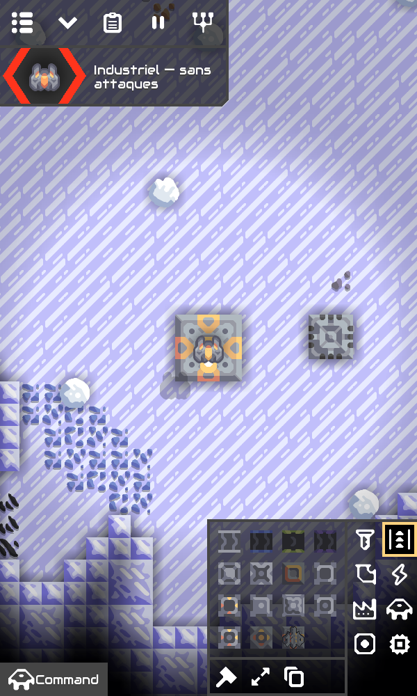
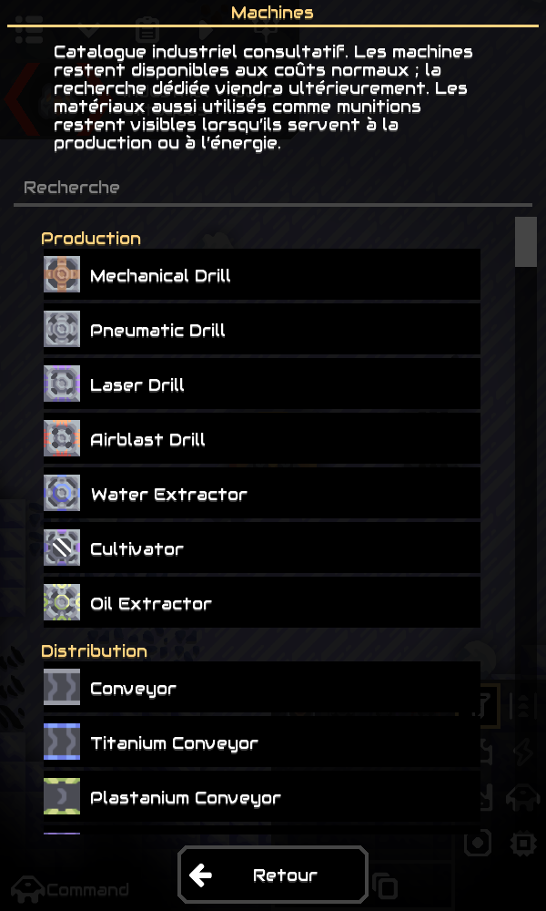
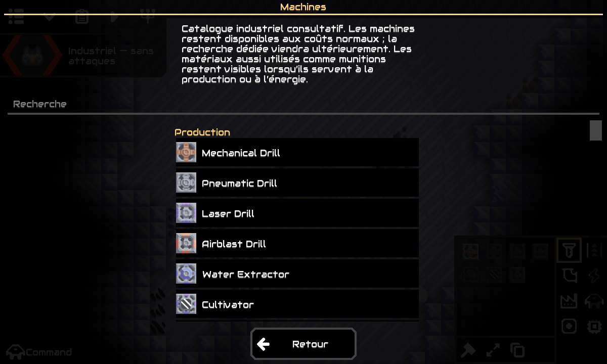
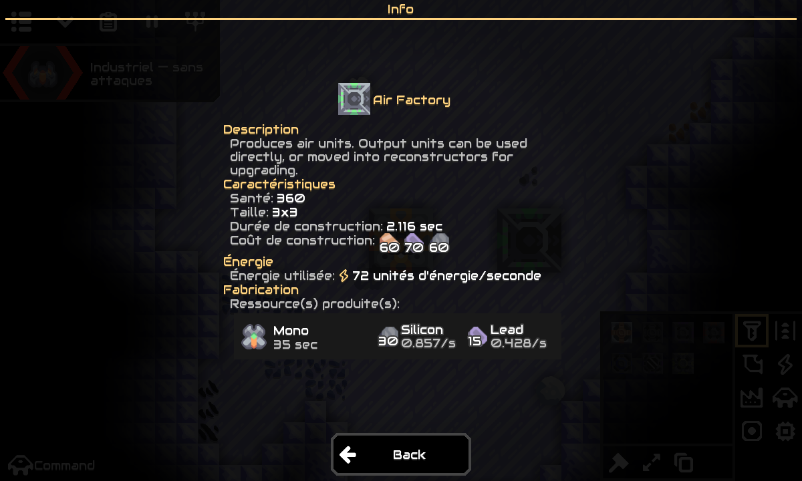
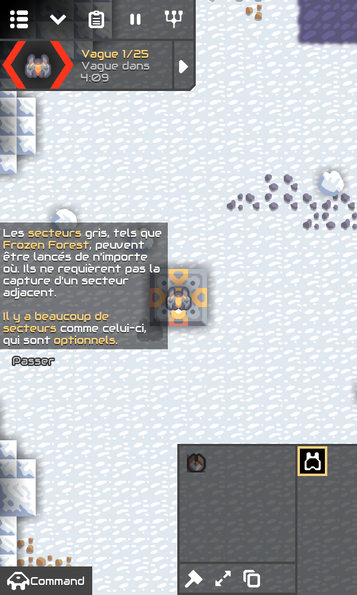
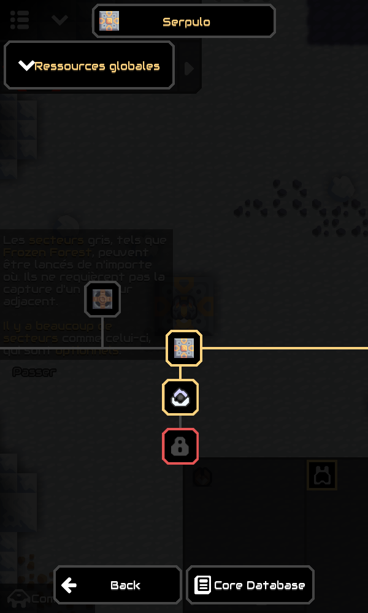

# Mission 5 — interface industrielle

Les menus industriels masquent le contenu exclusivement militaire. Les contenus restent dans le moteur et les sauvegardes ; les menus et recherches des parties classiques conservent leur comportement.

## Installation Android

- **[Télécharger le ZIP APK M5 et ses sources](https://github.com/Ankool29/Mindustry-Industrial/actions/runs/41978301897/artifacts/13392802390)**
- [Compilation GitHub Actions réussie — 41978301897](https://github.com/Ankool29/Mindustry-Industrial/actions/runs/41978301897)
- [Sources exactes — 15f0e6cfcc7a4f2146290661529ff852673aaf45](https://github.com/Ankool29/Mindustry-Industrial/tree/15f0e6cfcc7a4f2146290661529ff852673aaf45)

Extraire l’artefact **Mindustry-Industrial-Android**, puis ouvrir `Mindustry-Industrial-v160.7-m5.apk`. Installer par-dessus M3 ou M4 **sans désinstallation** : même package `io.anuke.mindustry.industrial.m3`, même certificat de test, code de version Android **5**. Les données industrielles et classiques restent dans leurs fichiers actuels.

Ouvrir **Jouer → Campagne → Serpulo industrielle**. Les menus de construction sont filtrés. Le bouton **Machines** ouvre un catalogue consultatif, avec recherche et fiches techniques. Le même filtre s’applique au mode Industriel des parties personnalisées.

## Modifications

`IndustrialContent` centralise une politique de présentation, sans écrire de règles, de recettes, de déblocages ni de paramètres de secteur. Le filtre s’applique aux catégories/blocs de construction, aux options de configuration des fabriques et constructeurs, à leurs fiches de production, aux schémas proposés, à la base de données et aux statistiques d’armes/munitions. Les conseils de tir, de gardien, de tourelle anti-incendie et de conquête classique sont également masqués en industriel ; le filtre ne marque pas ces conseils comme terminés dans les préférences classiques.

Les tourelles offensives, murs et portes défensifs, mines, boucliers, tours offensives et chaînes de fabrication exclusivement combattantes sont masqués. Les catégories militaires vides n’offrent plus de bouton. Les schémas contenant de tels blocs sont masqués dans le sélecteur industriel, sans suppression de leurs fichiers. Un bâtiment militaire déjà présent dans une ancienne sauvegarde n’est ni retiré ni transformé ; les recettes et configurations enregistrées continuent à fonctionner.

M4 ne possédait pas d’arbre technologique industriel : **Machines** affichait un texte. M5 remplace ce texte par un catalogue filtré en lecture seule. Il ne contient aucun nœud de recherche militaire ni achat de recherche. Les machines restent disponibles selon le fonctionnement M4 et leurs coûts normaux ; aucun arbre progressif nouveau ni changement de progression n’est introduit. L’arbre classique reste intact.

## Dépendances conservées

- Foreuses, convoyeurs, tri, conduites, pompes, stockage, énergie, machines de transformation, logique et infrastructures logistiques d’origine.
- Transport, chargement, déchargement, construction et déconstruction de charges utiles, pilotes de masse et infrastructures de lancement existantes.
- Drones capables de miner, construire ou transporter, ainsi que leurs fabriques et reconstructeurs. Certaines unités comme Nova ou Mega sont armées mais ont un usage civil : leur suppression retirerait cet usage. Les nouvelles fabriques sélectionnent par défaut une option civile ; les configurations déjà sauvegardées sont conservées. Les options purement combattantes et les statistiques d’armes/munitions sont masquées dans l’interface industrielle.
- Matériaux à usage mixte : cuivre, graphite, silicium, thorium, pyratite, composé explosif, etc. Ils restent nécessaires aux coûts, aux recettes ou aux combustibles. Le composé explosif alimente notamment le réacteur à impact. Un matériau n’est donc pas retiré au seul motif qu’une tourelle l’utilise aussi comme munition.
- Réparation des bâtiments/drones et accélération de production, utiles à la maintenance industrielle.

Aucun changement de génération, d’expansion des secteurs, de recette ou de simulation hors écran n’est apporté. Les environnements et restrictions planétaires restent ceux de M4 : conserver un contenu ne le rend pas automatiquement utilisable sur chaque planète.

## Validation

Cinq nouveaux tests automatisés couvrent :

1. Contenus militaires masqués en campagne industrielle et en partie personnalisée Industriel, mais visibles en campagne classique ; conseils de conquête masqués uniquement en industriel.
2. Conservation des unités civiles et hybrides, des infrastructures de charges utiles et des prérequis de reconstruction ; options civiles dans les configurations, choix Mono par défaut pour une nouvelle fabrique aérienne, options classiques conservées hors mode industriel.
3. Visibilité de tous les matériaux de construction et intrants fixes des machines conservées, de leurs liquides et des besoins des unités civiles ; maintien des catégories de production, transformation, énergie, distribution, liquides et logique.
4. Absence de mutation des recettes, listes de plans, visibilité native et déblocages classiques ; restauration du contexte de catalogue même si son rendu est interrompu.
5. Sauvegarde puis rechargement d’un bâtiment militaire et de son inventaire dans une partie industrielle : contenu conservé mais masqué dans le menu, stock du noyau préservé.

Les huit scénarios industriels M3, les cinq scénarios de campagne M4 et les tests amont restent inclus dans la CI. La compilation finale a réussi : **353 tests, aucun échec, aucune erreur et aucun test ignoré**. Le rapport [Gameplay-test-reports](https://github.com/Ankool29/Mindustry-Industrial/actions/runs/41978301897/artifacts/13393360673), téléchargé et relu, contient les cinq nouveaux tests M5, les huit M3, les cinq M4 et les tests amont. Les cinq nouveaux scénarios ont également été exécutés avec succès dans l’environnement cloud.

La CI construit les atlas puis l’APK, vérifie signature, package, bibliothèques ARM64, sprites et alignement ZIP 16 Kio. Les [preuves de compilation](https://github.com/Ankool29/Mindustry-Industrial/actions/runs/41978301897/artifacts/13392947112) et les versions d’outillage sont archivées.

Le banc graphique local utilise le client en mode `-testMobile`, avec dispositions portrait 600×1000 et paysage 1200×720. Il teste d’abord une campagne classique, puis charge une copie des véritables sauvegardes du contrôle M4. Il vérifie l’usine de graphite et les 500 cuivre conservés, les catégories industrielles, l’absence d’entrées militaires dans le catalogue, les matières à usage mixte, les options Mono/Flare de la fabrique aérienne, puis le retour à la campagne classique avec tourelles et arbre de recherche disponibles. Le déblocage de Duo est réalisé uniquement dans ce profil de test isolé, pour examiner son bouton.

Le [script du parcours industriel et du retour classique](docs/mission5/ui-check.js) et le [contrôle classique séparé](docs/mission5/original-ui-check.js) ne sont pas inclus dans l’APK. Le second a chargé un secteur Serpulo classique numéroté, vérifié les vagues actives et les dimensions du bouton Duo après mise en page, puis ouvert l’arbre de recherche original. Les deux contrôles ont réussi.

## Limites

Le catalogue ne constitue pas encore un arbre de recherche progressif. Les unités à usage mixte conservent leurs caractéristiques et armes dans le moteur : cette mission filtre l’interface et ne réécrit pas leurs comportements. Les contenus cachés restent disponibles dans les parties classiques. Les mods et imports manuels peuvent proposer d’autres contenus ; ce filtre d’interface ne constitue pas une interdiction de simulation.

La signature reste une clé de test. Le workflow exige le certificat M3/M4 connu et échoue si la clé de cache manque ou diffère ; une conservation durable dans GitHub Secrets reste nécessaire avant une distribution de production. Les artefacts sont conservés 30 jours. Les sources correspondantes et licences Mindustry/Arc sont jointes au ZIP.

Les essais graphiques en disposition mobile dans le cloud ne remplacent pas l’installation de cet APK sur un S25 Ultra physique. M4 a été confirmé fonctionnel sur Android par l’utilisateur ; M5 doit encore être essayé sur le téléphone.

## Vérification de l’APK téléchargé

Après téléchargement de l’artefact final, la signature et l’alignement 16 Kio ont été revérifiés. Le package est `io.anuke.mindustry.industrial.m3`, le code de version **5**, et le certificat est identique à M3/M4 : `61254fd2280bf34aa64bd06405cf0e2bc9b2d8fe7df4cc615c39983bcdfd8086`.

SHA-256 de l’APK : `9cc704600a1f9f54f8a41628893340caf006a9b9d4f44320cc452b7733e2717c`. La somme correspond au fichier `SHA256SUMS.txt` joint. Le ZIP contient l’APK, le guide Android, les sources correspondantes du fork et d’Arc, ainsi que leurs licences.
