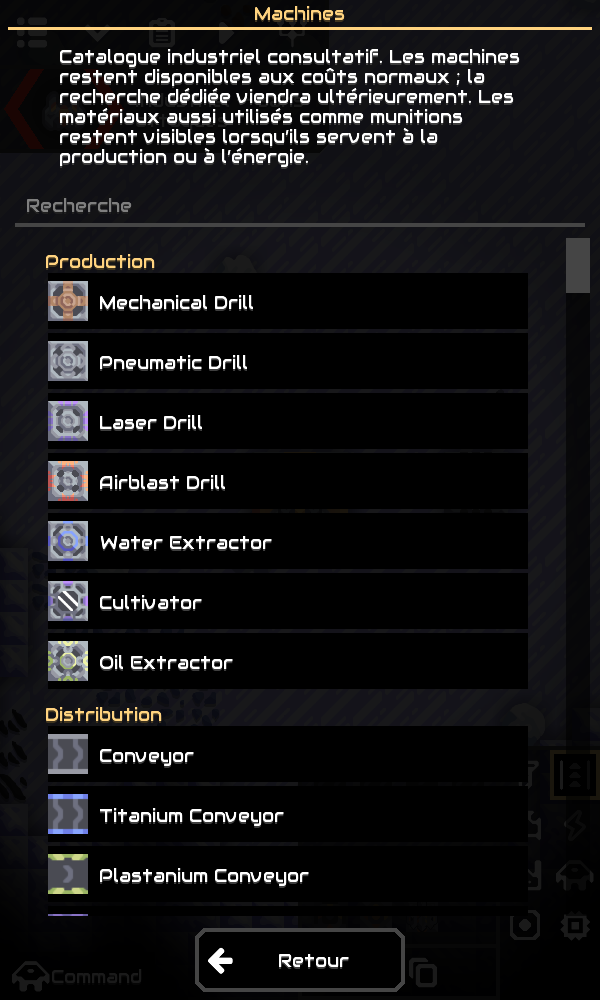
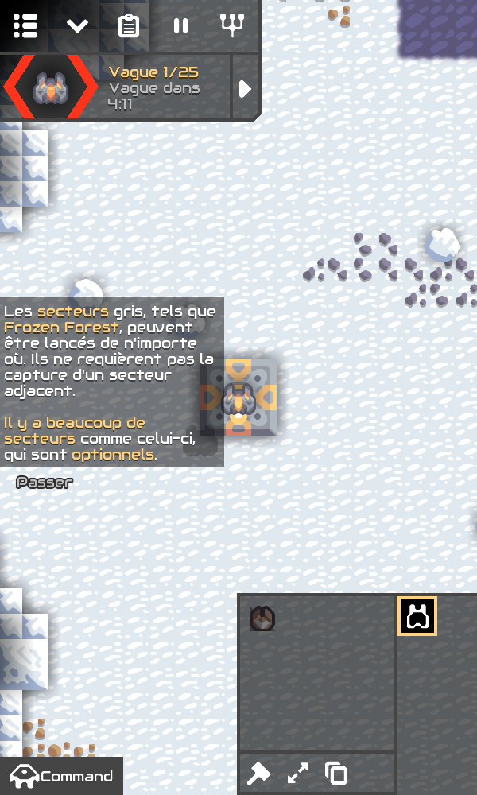
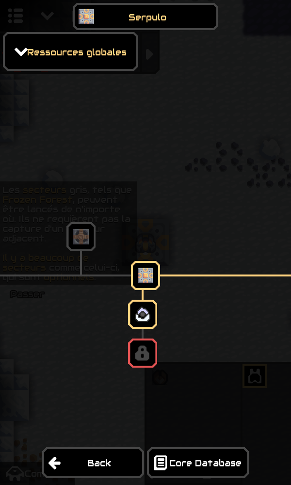

# Mission 6B — isolation de la progression technologique

La campagne industrielle dispose d’un état de recherche indépendant. **Aucune restriction de progression n’est activée** : toutes les technologies restent utilisables, le catalogue Machines est conservé et aucun paiement n’est déclenché par l’interface actuelle.

## APK Android

- **[Télécharger le ZIP APK M6B et ses sources](https://github.com/Ankool29/Mindustry-Industrial/actions/runs/41983683363/artifacts/13395341877)**
- [Compilation GitHub Actions réussie — 41983683363](https://github.com/Ankool29/Mindustry-Industrial/actions/runs/41983683363)
- [Sources exactes — dbab69e70c18b8c5b78497cad25e5e84668365a6](https://github.com/Ankool29/Mindustry-Industrial/tree/dbab69e70c18b8c5b78497cad25e5e84668365a6)

Extraire le ZIP de l’artefact **Mindustry-Industrial-Android**, puis ouvrir `Mindustry-Industrial-v160.7-m6b.apk`. Installer par-dessus M3/M4/M5 **sans désinstallation**. Le package reste `io.anuke.mindustry.industrial.m3`, le certificat reste celui de M3/M4/M5 et le code de version Android passe à **6**.

## Modifications

### État séparé

`IndustrialResearch` enregistre un profil versionné dans les paramètres natifs de l’application, sous `industrial-research-v1-industrial-serpulo`. Trois ensembles sont séparés : technologies étudiées, découvertes de matières et paiements partiels. Les identifiants utilisent le type et le nom du contenu, et les noms des matériaux pour les contributions ; ils ne dépendent pas des numéros de contenu.

Les clés classiques `<contenu>-unlocked` et `req-<contenu>-<matériau>` ne sont ni copiées, ni migrées, ni modifiées par ce service. Les découvertes de matières passent par les appels natifs de production/découverte déjà présents, mais ne déclenchent aucun événement global de déblocage classique. Les déblocages classiques ne remplissent pas le profil industriel.

Le profil est inclus dans l’export/import complet des données du jeu, comme les recherches natives. Exporter uniquement un fichier de secteur ne suffit pas à transférer toute la recherche planétaire. Les sauvegardes M4/M5 n’avaient pas de recherche industrielle persistante : elles sont conservées sans conversion des blocs ou restriction nouvelle. Le profil porte un indicateur d’accès libre ; en 6B cet accès reste explicitement actif pour toutes les campagnes industrielles.

### Nœuds natifs sans interaction classique

Un constructeur supplémentaire de `TechNode` permet de créer des nœuds détachés. Le constructeur classique garde son comportement d’origine. Les nœuds industriels :

- Référencent les mêmes objets de contenu ; aucune machine, unité, recette ou identité de contenu n’est dupliquée.
- Possèdent leurs propres tableaux de coûts et contributions.
- Ne remplacent pas `content.techNode` et ne modifient pas `content.techNodes`.
- N’entrent ni dans `TechTree.all` ni dans `TechTree.roots`, ce qui les laisse hors du parcours de déblocage automatique classique.
- Chargent et sauvegardent leurs contributions dans le profil industriel uniquement.

`IndustrialResearch.tree()` construit à la demande un arbre technique de préparation à partir de Serpulo, filtré avec la politique industrielle M5. Les descendants utiles de nœuds militaires exclus sont rattachés à leur parent conservé. Les objectifs classiques de conquête ou de présence sur un secteur prédéfini ne sont pas importés. Les références de recherche/découverte utilisent des objectifs explicitement industriels.

Cet arbre n’est pas affecté à `Planet.techTree` et n’est pas proposé au joueur : le catalogue Machines reste le seul écran industriel de consultation. Il s’agit d’une fondation technique ; le dessin définitif de la progression, les jalons et son intégration dans l’écran natif de recherche relèvent d’une mission suivante. Le futur écran devra utiliser le service industriel pour les paiements et déblocages.

### Stocks et objectifs

La lecture des ressources et la fonction de paiement sont limitées aux bases non gelées de **Serpulo industrielle**, sans repli sur Serpulo classique. Les ressources sont retirées avec les méthodes natives `Sector.items()` et `Sector.removeItem()` ; les bases non visitées sont utilisées avant la base active. Les recherches peuvent recevoir des contributions partielles, et une action sur un arbre ancien recharge les contributions persistantes avant de prélever.

La fonction de paiement est explicite et réservée au futur écran. Elle vérifie le parent et les objectifs industriels ; elle n’est appelée ni par le catalogue, ni par la simulation. Elle refuse les actions d’un client réseau. La disponibilité actuelle des machines reste indépendante de ces écritures de préparation.

Les objectifs de recherche, découverte et nombre de bases industrielles actives implémentent l’interface native `Objective`. Les bases classiques ne comptent pas dans un objectif d’expansion industrielle. Aucun jalon ne verrouille actuellement une technologie ou un secteur.

### Comportements conservés

Aucun changement de recette, coût de machine, coût de colonisation, sélection des voisins, génération, format binaire de secteur ou simulation hors écran. Le code de `Universe`, les statistiques de production et le calcul économique des secteurs absents ne sont pas modifiés. La seule addition sur le chemin de découverte actif est l’enregistrement idempotent des matières dans le profil dédié.

## Tests

Six nouveaux scénarios automatisés vérifient :

1. Découvertes industrielles sans écriture des déblocages classiques, et absence de découverte industrielle lors d’un déblocage classique.
2. Contenus partagés, tableaux de coûts distincts, pointeurs/listes classiques inchangés, exclusion des listes d’auto-déblocage et absence de lecture des contributions classiques.
3. Paiement industriel de 4 puis 6 cuivre sur une recherche de 10, persistance après sauvegarde et reconstruction des paramètres, déblocage séparé, absence de double débit et conservation d’un stock classique de 900 cuivre.
4. Deux arbres chargés avant le paiement : contributions persistantes relues avant le second prélèvement, sans écrasement par un état ancien.
5. Objectifs de découverte/recherche indépendants et jalons d’expansion comptant uniquement les bases industrielles.
6. Prélèvement dans une base industrielle non visitée puis dans le noyau actif, sans toucher à une base classique ; accès libre et exploration des voisins toujours disponibles.

**359 tests, aucun échec, aucune erreur et aucun test ignoré** dans la compilation GitHub Actions finale. Le rapport [Gameplay-test-reports](https://github.com/Ankool29/Mindustry-Industrial/actions/runs/41983683363/artifacts/13395750672) a été téléchargé et relu : il confirme les six nouveaux scénarios et tous les tests précédents. Les six scénarios ont aussi réussi dans le cloud avant la compilation. Les [preuves Android](https://github.com/Ankool29/Mindustry-Industrial/actions/runs/41983683363/artifacts/13395705842) contiennent versions, signature et vérifications du paquet.

Le client graphique a été lancé **dans deux processus Java distincts**, avec le même profil de test, en disposition mobile portrait 600×1000. Le [script de contrôle](docs/mission6b/restart-check.js), absent de l’APK, a chargé une copie des véritables sauvegardes du contrôle M4 : presse à graphite conservée et noyau à 500 cuivre avant toute manipulation du banc de test.

Dans ce seul profil de test, le premier processus a préparé un stock de 4 cuivre, versé cette contribution sur la recherche de la foreuse mécanique à 10 cuivre, puis enregistré secteur et paramètres avec 6 cuivre en réserve. Le second processus a retrouvé la contribution de 4 et le stock de 6, terminé la recherche avec ce solde et vérifié l’absence de modification du déblocage et du paiement classiques correspondants. Les machines avancées sont restées accessibles avant et après cette recherche de démonstration. Ce paiement est un appel du banc de test, pas une nouvelle action visible au joueur.

Le même contrôle a ensuite rejoint un secteur Serpulo classique, vérifié les vagues actives, le bouton Duo et l’ouverture de l’arbre de recherche original. Le déblocage de Duo appartient uniquement au profil de test isolé.

## Limites et suite

Cette mission prépare la persistance et les services, sans activer l’arbre de progression 6A. Les paiements sont testés par des appels explicites dans des profils de test isolés ; aucun bouton de dépense n’a été ajouté au jeu. Le catalogue doit être remplacé seulement lorsqu’un écran de recherche industriel complet sera disponible.

Les objectifs d’expansion comptent ici les bases actuellement établies ; aucun historique de colonisation payante n’est créé. Les coûts supplémentaires et transactions de colonisation ne sont pas implémentés. L’activation d’une progression stricte nécessitera une migration explicite qui respecte l’accès libre des anciennes campagnes.

Les tests graphiques en disposition mobile dans le cloud ne remplacent pas un essai de cet APK sur le Samsung Galaxy S25 Ultra. Les mods qui changent le moteur et les parties entre versions différentes ne sont pas couverts. La signature reste une clé de test conservée par le cache GitHub ; la CI refuse de la remplacer si elle manque. Les artefacts expirent après 30 jours. Le ZIP contient les sources correspondantes et licences Mindustry/Arc.

## Vérification de l’APK téléchargé

Après téléchargement, la signature, l’identifiant `io.anuke.mindustry.industrial.m3`, le code de version **6** et l’alignement ZIP 16 Kio ont été revérifiés. Le certificat reste `61254fd2280bf34aa64bd06405cf0e2bc9b2d8fe7df4cc615c39983bcdfd8086`, identique à M3/M4/M5.

SHA-256 de l’APK livré : `af49ce91e8dc50da289188277a6b41cd45d49bd8eeaccb66bc3cba66dde2527e`. La somme correspond au fichier `SHA256SUMS.txt` joint. Le ZIP contient aussi le guide Android, les sources correspondantes et les licences.
