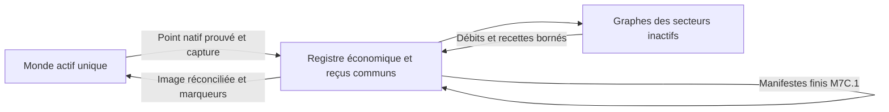

# M7D-A — audit de la simulation économique hors écran

**Statut : architecture proposée, à valider ; aucune implémentation M7D.** Audit du 10 novembre 2026, référence `feature/m7c-conservative-transports` au commit `e90462f38ed056f02038e374979d60f1066063f0` ; code M7C.1 `32ba1e1210c873a47d45009bfe7c24591f7dcc1f`, base Mindustry v160.7. Aucun gameplay, monde, journal économique ou paramètre du joueur modifié ; aucun test de jeu ni APK relancé.

Les audits historiques restent valables : [M7A/M7B](docs/codex/DECISIONS.md#preuves-existantes), [M7C](MISSION_7C_VALIDATION.md), [M7C.1](MISSION_7C1_VALIDATION.md). Ce rapport approfondit les intrants, les flux locaux et le transfert d’autorité nécessaires à l’autonomie ; il ne refait pas l’historique des missions.

## 1. Conclusion et périmètre

**Recommandation : un graphe économique conservatif par secteur inactif, composé de tampons, processus et liaisons réellement présents, avec un registre transactionnel commun aux transports.** Un seul monde complet reste actif. Ne pas mettre tous les stocks d’un secteur dans un réservoir fictif et ne pas transformer les moyennes natives en réserves disponibles.

M7C.1 transporte des lots déjà financés, mais ne fait pas fonctionner les foreuses, les déchargeurs, les conduites, la charge des rampes ou les sorties des réceptions inactives. Pour la chaîne demandée, il manque donc les deux côtés du transport : **produire et remplir/recharger la rampe A**, puis **vider la réception vers un stockage B** sans visite.

Le premier prototype doit être limité à des implantations simples et explicitement compatibles, sous activation expérimentale de la campagne progressive. Il doit créer **de nouveaux** colis depuis un départ sans cuivre ni colis préchargés ; montrer seulement l’acheminement des anciens lots M7C.1 ne validerait pas M7D.

## 2. Cartographie vérifiée du code

Liens relatifs : ils décrivent les sources de la référence auditée ci-dessus, non un nouveau code M7D.

| Sujet | Source et mécanisme | Conséquence |
| --- | --- | --- |
| Temps et production inactive | [Universe.runTurn](core/src/mindustry/game/Universe.java#L151), [Logic.update](core/src/mindustry/core/Logic.java#L508) | Tour de 7 200 ticks = 120 secondes de jeu ; campagne non pausée. Pas de progression application fermée. Les autres planètes hors groupe ne sont pas avancées. |
| Moyennes | [SectorInfo](core/src/mindustry/game/SectorInfo.java#L106), `update/updateDelta/updateStats` | Deltas du noyau, production déclarée, imports/exports ; échantillonnage de 60 ticks, fenêtre de 60 échantillons. Descriptions d’activité, pas bilan de recettes. |
| Stocks du noyau | [Sector.items/addItems/removeItem](core/src/mindustry/type/Sector.java#L212) | Monde actif : module du noyau ; inactif : `info.items`. `addItems` plafonne et les corrections négatives peuvent masquer un dépassement de demande. Ne pas l’utiliser comme transaction comptable aveugle. |
| Sauvegarde/reprise des stocks | [SectorInfo.prepare/write](core/src/mindustry/game/SectorInfo.java#L165) | `prepare` copie le noyau vers les paramètres ; `write` réinjecte `info.items` dans le noyau chargé, en l’écrasant et en bornant sa capacité. Point de conflit majeur avec un futur registre. |
| Foreuses | [DrillBuild.updateTile](core/src/mindustry/world/blocks/production/Drill.java#L287), `countOre/getDrillTime` | Minerai dominant sous l’empreinte, tier/dureté, progression, chauffe, efficacité et boost liquide ; sortie limitée par son tampon. |
| Recettes | [GenericCrafterBuild](core/src/mindustry/world/blocks/production/GenericCrafter.java#L237), `craft/shouldConsume` | Entrées par cycle, liquides continus, sorties/capacités et progression ; pas un simple taux constant. |
| Consommations | [BuildingComp.updateConsumption](core/src/mindustry/entities/comp/BuildingComp.java#L1950), [ConsumeItems](core/src/mindustry/world/consumers/ConsumeItems.java), [ConsumeLiquid](core/src/mindustry/world/consumers/ConsumeLiquid.java), [ConsumePower](core/src/mindustry/world/consumers/ConsumePower.java) | Conditions dynamiques, optionnels, minimum des efficacités, consommations déclenchées et continues distinctes. |
| Stockages et convoyage | [CoreBlock](core/src/mindustry/world/blocks/storage/CoreBlock.java#L758), [StorageBlock](core/src/mindustry/world/blocks/storage/StorageBlock.java), [ConveyorBuild](core/src/mindustry/world/blocks/distribution/Conveyor.java#L125), [Unloader](core/src/mindustry/world/blocks/storage/Unloader.java#L220) | Stockages liés et noyaux partagent parfois le même `ItemModule`. Les convoyeurs ont aussi des listes d’objets et positions propres ; les déchargeurs ont une sélection et une cadence. |
| Électricité | [PowerGraph](core/src/mindustry/world/blocks/power/PowerGraph.java#L216), [PowerModule](core/src/mindustry/world/modules/PowerModule.java), [ConsumeGenerator](core/src/mindustry/world/blocks/power/ConsumeGenerator.java), [SolarGenerator](core/src/mindustry/world/blocks/power/SolarGenerator.java) | Réseaux distincts, offre/demande, batteries et carburant restant ; solaire dépendant de l’éclairage, pas de la moyenne de la dernière visite. |
| Liquides | [LiquidModule](core/src/mindustry/world/modules/LiquidModule.java), `BuildingComp.moveLiquid/acceptLiquid` | Volumes réels par module, capacités, connectivité, acceptation/pression ; les mesures de débit ne sont pas des réserves. |
| Transports actuels | [IndustrialTransports](core/src/mindustry/game/IndustrialTransports.java#L197), [LaunchPad](core/src/mindustry/world/blocks/campaign/LaunchPad.java#L144), [LandingPad](core/src/mindustry/world/blocks/campaign/LandingPad.java#L274) | Manifestes finis et reçus, relevés des tampons, reprise des arrivées appariées ; aucun remplissage/vidage local hors écran. |
| Persistance | [SaveIO](core/src/mindustry/io/SaveIO.java#L44), [BuildingComp.writeBase/readBase](core/src/mindustry/entities/comp/BuildingComp.java#L185), méthodes `write/read` des blocs | Modules, état spécifique des machines, marqueurs et génération à réconcilier ; appeler des bâtiments inactifs via `updateTile` lirait le monde global et n’est pas une solution. |
| Dépenses externes | [IndustrialResearch.spend](core/src/mindustry/game/IndustrialResearch.java#L253), [IndustrialExpansion.recover](core/src/mindustry/game/IndustrialExpansion.java#L115) | Recherche via `Sector.removeItem` ; M6D retire directement dans `source.info.items`. Ces deux chemins doivent consulter/débiter l’autorité économique future, sans changer leurs coûts. |

### Calcul natif exact et limites

Pour un secteur inactif admissible, la production applique par matière :

```text
stock += min(troncature(moyenneProduction × secondesDuTour), capacité − stock)
puis suppression des stocks négatifs
```

Cela ne parcourt aucune recette, machine, réserve de carburant, conduite ou batterie inactive. Une moyenne négative ne vérifie pas les intrants d’une autre matière ; les moyennes positives peuvent continuer après une pénurie. La troncature perd des fractions de production théorique. Les limites de stockage du noyau ne représentent pas celles des machines ni les bouchons des convoyeurs.

**Preuve déjà exécutée, non relancée ici :** le test M7B conservé dans M7C.1 produit 5 graphite avec les intrants physiques, puis atteint 35 hors écran et retrouve 35 au retour, malgré les intrants épuisés. Les 438 tests M7C.1 réussis ne démontrent donc pas une économie globale conservative. Les imports actifs peuvent aussi alimenter des statistiques de production ; ajouter un vrai crédit M7D tout en gardant cette projection doublerait certains effets.

Dans la progressive, M7C.1 neutralise les crédits statistiques de transport, **pas** cette formule de production. Dans les modes classique et libre, ne modifier aucun de ces chemins.

## 3. Trois architectures possibles

| Option | Précision / risques | Complexité, Android et compatibilité |
| --- | --- | --- |
| Réservoir unique par secteur + recettes bornées | Peut équilibrer des quantités, mais rend accessibles des stocks physiquement déconnectés, escamote les tampons et capacités locales, favorise téléportation et débits irréels. Réconciliation difficile des bâtiments. | Faible CPU ; développement initial simple, dette élevée. Non recommandé. |
| Objets natifs de tous les bâtiments, mis à jour hors carte | Fidélité seulement avec contexte monde complet, temps, voisins, groupes et effets ; nombreux accès à `Vars.world/state`. Une copie naïve peut modifier le monde actif. | Coût proche de plusieurs mondes, mémoire/CPU élevés, fortes difficultés de sauvegarde. Écarté. |
| **Graphe compact de tampons/processus/liaisons, adaptateurs limités** | Stocks réels, recettes et capacités explicites ; approximation contrôlée du temps et du convoyage. Machines inconnues suspendues, jamais remplacées par une moyenne. | Complexité initiale moyenne/élevée ; coût proportionnel au graphe utile. Contenus natifs réutilisés, pas de nouvelles machines. Recommandé avec activation progressive et tests différentiels. |

Il ne s’agit pas d’un second moteur indépendant des transports : les soldes et les manifestes doivent partager la même autorité de transaction.

## 4. Modèle recommandé

### Données extraites au dernier point de sauvegarde

Pour chaque secteur : identité planète/secteur, génération du monde, version des adaptateurs, empreinte de topologie/configuration, horloge de simulation et point de sauvegarde natif. Capturer, sans compter deux fois :

- Chaque **module propriétaire** d’objets : noyau/stockages liés dédupliqués, tampons des foreuses, machines, rampes et réceptions, contenu réellement porté par les liaisons.
- Les volumes de liquides, leur type, les filtres et capacités ; pétrole d’une rampe distinct de celui du réservoir voisin.
- Les réseaux électriques connectés, producteurs, consommateurs et énergie des batteries. Pour un consommateur, `power.status` est une couverture de demande, **pas de l’énergie stockée** ; pour une batterie, il représente une fraction de sa capacité.
- Progressions, chauffe, charge de rampe, combustible déjà engagé, arrivée appariée et eau déjà consommée. Ne pas reconsommer ce qui a déjà financé une progression.
- Les liaisons dirigées réellement possibles, débits/capacités et latences. Deux stockages du même secteur non reliés ne s’échangent rien.

La liste `SectorInfo.resources` indique une présence géologique, pas une réserve exploitable par toutes les foreuses. La foreuse doit être construite, compatible avec le minerai effectivement couvert et alimentée selon ses règles. Les minerais natifs actuellement infinis restent des **sources d’extraction explicites** ; ne pas inventer des gisements finis ou une règle d’épuisement dans ce prototype.

**Piège des doubles représentations :** `ConveyorBuild.ids/len/positions` et son `ItemModule` ne sont pas deux stocks ; plusieurs noyaux/conteneurs peuvent partager un seul module. À la reprise, restaurer seulement `items` d’un convoyeur laisserait ses objets internes incohérents.

### Avancement borné et déterministe

Proposition à valider : pas économique nominal de 5 secondes de **jeu**, sous-découpé aux événements nécessaires (fin de cycle, épuisement, saturation, arrivée). Ordre stable des secteurs/processus et politique équitable de concurrence documentée. Réutiliser paramètres et recettes natifs, via adaptateurs purs ; ne pas exécuter `Building.updateTile()` sur des pseudo-mondes.

Pour une recette par lots, le nombre de cycles terminables est borné simultanément par la progression/temps, chaque intrant disponible, l’espace de chaque sortie, les liquides et l’énergie réellement alloués. Réserver toutes les entrées et places de sortie avant d’appliquer un cycle. Les liquides continus et la charge d’une rampe consomment **pendant la progression**, même si aucune sortie n’est encore produite ; ne pas repousser tout leur coût à la fin. Gérer les stocks déjà engagés dans un cycle.

Un même intrant ne peut financer deux processus. Les sorties nouvelles ne peuvent être réutilisées en boucle infinie dans le même instant ; cycles de recettes et transferts respectent l’horloge. Une liaison débite sa source et crédite sa destination/sa file dans une transaction, avec place réservée et limitation de débit. Une longue ligne de convoyeurs ne se réduit pas à un échange instantané : une compression future de segments droits devra conserver leur contenu, délai et capacité, puis restaurer des positions valides.

La capacité peut être par matière, totale ou partagée selon le bloc : réutiliser son contrat d’acceptation, sans règle universelle fondée sur `items.total()`. Les identités persistantes utilisent planète, secteur, génération et propriétaire stable du tampon ; ne pas sauvegarder un pointeur Java comme identité.

Les objets sont des quantités entières ; progression et volumes nécessitent des restes persistants. Recommandation : unités comptables explicites, précision fixe ou rationnelle adaptée et restes conservés aux conversions IEEE754 natives. **Ne pas arrondir chaque visite vers le haut, ni jeter silencieusement les fractions.** La politique de précision reste à spécifier/tester avant implémentation ; conservation comptable et égalité bit à bit avec l’ordre d’addition des flottants natifs sont deux exigences différentes.

Invariant par matière sur un intervalle :

```text
stocksFinaux + cargaisonsEncorePropriétaires
  = stocksInitiaux + extractionValidée + sortiesDeRecettes
    − entréesDeRecettes − dépensesExternes − destructionsExplicites
```

Un reçu ne compte pas comme un deuxième stock. L’énergie et chaque liquide ont leur propre bilan. Les conversions de recettes ne conservent pas nécessairement le nombre total d’objets (ex. 2 charbon → 1 graphite). Toute destruction native volontaire doit être nommée et comptée ; une saturation ordinaire bloque le processus ou conserve l’excédent, sans perte silencieuse.

### Énergie et liquides

Établir le bilan séparément pour chaque réseau électrique. Produire selon les entrées réelles des générateurs et leur état engagé ; puiser la différence dans les batteries sans dépassement. Une batterie vide ou un combustible épuisé réduit/arrête la charge et les recettes. Ne jamais prolonger `efficiency=1` ou `PowerGraph.getPowerBalance()` comme une promesse d’alimentation future.

Le solaire exigera un adaptateur utilisant l’éclairage du **secteur considéré** et l’horloge de campagne ; l’éclairage courant de C n’est pas celui de A. Les générateurs complexes, surcadences, réacteurs et logique ne doivent pas être acceptés par défaut.

Chaque prélèvement de liquide est borné par le volume réellement accessible via des liaisons supportées ; une connexion physique ne justifie pas une réserve globale illimitée. Respecter le débit/acceptation des conduites, les réservoirs et les consommations optionnelles. Eau extraite d’une source native et pétrole produit par une recette sont des opérations explicites, jamais des moyennes. Les filtres/mélanges et effets non pris en charge suspendent le circuit concerné.

## 5. Intégration indispensable aux transports M7C.1

[IndustrialTransports.launch/afterSave/turn/loaded](core/src/mindustry/game/IndustrialTransports.java) constituent le contrat actuel. Les conserver pour les secteurs non confiés au futur agrégateur ; pour les secteurs gérés, passer par un **coordinateur commun** sans exécuter deux chemins pour le même lot.

| Origine / destination | Comportement proposé |
| --- | --- |
| A actif → B inactif | Source native M7C.1 : débit RAM puis preuve de sauvegarde ; manifeste fini. B ne dispose du contenu qu’après transaction de réception dans son graphe. |
| A inactif → B actif | Le graphe remplit réellement le tampon A et charge la rampe ; débit du tampon + création du manifeste dans **la même transaction durable**. Réception B native M7C.1, sans crédit statistique. |
| A et B inactifs, C actif | Même admission finie côté A ; arrivée vers le tampon B, puis transfert local B → stockage selon la liaison et son débit. Nul chargement des mondes A/B. |
| Un secteur non pris en charge | Pas de production/consommation agrégée supposée. Maintenir la conservation/attente des cargaisons M7C.1 ; afficher que l’autonomie n’est pas disponible. |

Pour A inactif, ne pas appeler `IndustrialTransports.launch()` avec un faux `LaunchPadBuild` : cette méthode utilise le secteur courant. Prévoir une admission pure avec source/destination explicites dans le coordinateur, conservant le même contrat de financement, d’identifiants et de reçus.

**Rampe inactive :** reprendre `launchCounter`, l’inventaire et les consommations natives. La rampe avancée a un tampon de **100 objets**, une charge nominale de **30 s**, **8 unités électriques/tick** (= 480/s) et **9 pétrole/s** pendant la charge ; réservoir interne de seulement **40 pétrole**. Il faut donc un approvisionnement local réel pour recharger, pas simplement « 270 pétrole présents dans le secteur ». Une charge complète nominale représente 14 400 unités d’énergie et environ 270 pétrole ; les champs natifs, l’efficacité et les restes de progression font autorité. Une charge déjà payée ne l’est pas une seconde fois. Respecter la charge même lorsque la rampe attend encore ses objets, comme le natif.

**Réception inactive :** le coût natif est **1 500 eau/lot** (réservoir 3 000), diminué de l’eau déjà consommée si une arrivée était engagée. M7C.1 possède aujourd’hui un `overlay` qui conserve le lot jusqu’au chargement du monde. Le futur graphe doit pouvoir le recevoir et vider le tampon sans visite, **en transférant son autorité une fois**. Il est interdit de créditer le stockage B puis de laisser `IndustrialTransports.loaded()` réappliquer cet `overlay` ensuite. Conserver ID, reçu, destination unique et marqueur de livraison ; distinguer « reçu par économie agrégée » de « présent dans un monde sauvegardé ». Ne pas simuler de fusée multidestination.

**Stockage commun des transactions :** évoluer vers une version du registre qui englobe soldes agrégés, placements dans les files et manifestes/reçus M7C.1. Deux journaux indépendants avec débit dans l’un et création du colis dans l’autre recréeraient le problème d’atomicité. Proposer une migration versionnée, vérifiée et sauvegardée du v1, sans changer les IDs ni renvoyer les colis en cours ; aucune migration n’est effectuée dans cet audit.

## 6. Synchronisation : une seule autorité à chaque instant



Le registre est l’autorité des secteurs agrégés ; le monde est celle du secteur actif. `SectorInfo.items` devient une **vue** du stock de noyau agrégé, pas une seconde réserve à créditer. Cette évolution doit aussi préserver les lectures/dépenses de la recherche et de M6D.

### Sortie d’un secteur

1. Suspendre ses mutations et le prendre au même instant de simulation pour les transferts, recherches et dépenses de colonisation.
2. Enregistrer une intention durable contenant l’image économique, sa génération/topologie et un token de transition ; écrire/synchroniser le point natif portant ce token.
3. Après vérification de ce point, valider l’autorité agrégée et son instant initial. Ne pas commencer la production agrégée pendant que ce monde peut encore produire en natif.
4. Si interruption : token absent → pas d’avancement agrégé ; token présent mais validation manquante → réconcilier idempotemment ou bloquer. Ni nouveau stock par défaut ni relecture d’une vieille copie comme preuve actuelle.

### Retour dans un secteur

1. Arrêter son agrégateur à un instant déterminé, geler ses transactions entrantes/sortantes et drainer le travail validé. Les autres secteurs ne doivent pas pouvoir lui envoyer un crédit concurrent pendant l’application.
2. Charger **ce seul monde** depuis le point de référence ; vérifier génération, révision, empreinte et tokens avant toute mise à jour du jeu. Pour les secteurs gérés, adapter le chemin où `SectorInfo.write()` écrase le noyau ; ne pas ajouter une image par-dessus des stocks déjà projetés.
3. Appliquer une image autoritaire des modules/progressions, ou des deltas dont la base est strictement vérifiée. Restaurer une seule fois les modules partagés, l’état interne des liaisons, charges, batteries et arrivées/reçus. Recalculer les graphes natifs sans créer un stock supplémentaire.
4. Sauvegarder le monde réconcilié avec son epoch/dernier numéro de transaction, puis reconnaître l’autorité active dans le registre. Une interruption après cette sauvegarde mais avant l’accusé doit terminer la transition, pas réajouter les ressources.

Une incohérence est une suspension signalée, jamais un passage dans le traitement natif de `SaveException` qui pourrait supprimer/recréer le secteur. Prévoir l’intégration **avant les événements/déblocages ou premier tick** susceptibles de lire/modifier un monde encore non réconcilié.

**Limite explicite :** un registre unique rend atomiques ses propres transferts, pas l’ensemble registre + `.msav` + paramètres. Les fsync et tokens ne prouvent pas une transaction multi-fichier ACID. Restaurations partielles anciennes, erreurs de disque et coupures doivent être testées ; sauvegardes complètes cohérentes et quarantaine restent nécessaires. Le CRC/UUID ne prouve pas la fraîcheur absolue. Aucun rollback automatique vers un ancien journal au seul motif qu’il est lisible.

### Recherche, M6D et compatibilité

`IndustrialResearch.spend()` passe par `Sector.items/removeItem` ; `IndustrialExpansion.recover()` retire directement dans `source.info.items`. Ces opérations doivent réserver/débiter le solde autoritaire avec un ID de dépense idempotent et reconnaître une seule fois la progression de paiement/colonisation correspondante, puis mettre la vue à jour, sans re-facturer ni modifier prix, paiements partiels, compteurs ou règles de voisinage. Ne pas compter tout le stock industriel local comme stock de recherche : garder la sémantique native des stocks de noyau accessibles.

Adopter les stocks existants comme **soldes d’ouverture**, même si certaines unités viennent historiquement des anciennes estimations ; ne pas les recalculer, effacer ou prétendre en connaître la provenance.

Pour un mode réellement conservatif, l’activation expérimentale doit empêcher la projection native de production sur **tous les secteurs inactifs de cette campagne progressive**. Sinon, un secteur non géré pourrait continuer à créer des stocks estimés et les injecter dans le réseau « conservatif ». Les secteurs non supportés doivent alors rester gelés hors écran, avec explication ; visités, ils fonctionnent en natif. Pas de mélange automatique « graphe + moyenne pour le reste du même noyau ».

Recommandation de migration : activation explicite au niveau de la campagne progressive, sur copie isolée d’abord ; capture lors des visites, inventaire inchangé, pas de remise à zéro ni conversion automatique. Avant activation, comportement M7C.1 conservé. Après activation, suspension des productions inactives encore non capturées/non supportées annoncée au joueur. Ce choix de comportement doit être validé avant développement ; il ne touche ni classique ni libre. Un simple numéro de secteur ou un second bouton ne constitue pas un profil indépendant.

## 7. Performance Android : mesures disponibles et estimations

**Mesuré auparavant, pas relancé pour cet audit :** [M7C.1](MISSION_7C1_VALIDATION.md) rapporte 0,86–2,33 µs/appel du service de transport au repos pour 5/20/50/100 colonies synthétiques, et 0,79 ms/admission durable sur une file de 512 lots (journal 68 080 octets). Cela ne mesure ni des recettes, ni des circuits chargés, ni Android. Ne pas extrapoler ces microsecondes au futur moteur.

**Hypothèse de dimensionnement, non benchmark :** par secteur, 200 nœuds économiques et 400 liaisons, pas de 5 secondes. Soit au moins `N × (V + E) / 5` visites logiques/seconde ; allocations, recettes multi-intrants, événements, calcul électrique et I/O s’y ajoutent. Hypothèses de budget : état compact 0,25–1 Mio/secteur en mémoire et 64–256 Kio/secteur sérialisés.

| Secteurs | Visites de base / pas de 5 s | Moyenne / seconde | Mémoire économique estimée | Image disque estimée |
| --- | ---: | ---: | ---: | ---: |
| 5 | 3 000 | 600 | 1,25–5 Mio | 0,31–1,25 Mio |
| 20 | 12 000 | 2 400 | 5–20 Mio | 1,25–5 Mio |
| 50 | 30 000 | 6 000 | 12,5–50 Mio | 3,13–12,5 Mio |
| 100 | 60 000 | 12 000 | 25–100 Mio | 6,25–25 Mio |

Ces valeurs sont des **enveloppes d’ingénierie à mesurer**, pas des performances constatées. Mémoire hors monde actif/textures/JVM, disque hors `.msav`, sauvegardes et journal de transactions. Prévoir aussi une image précédente cohérente et un WAL global borné, par exemple cible 4–16 Mio à valider. À 100 secteurs, deux images au plafond + 16 Mio de WAL représenteraient environ 66 Mio supplémentaires. Objets Java, chaînes, double buffering et graphs plus grands peuvent dépasser ces enveloppes.

Mesures recommandées : 5/20/50/100 secteurs, mêmes nombres de nœuds puis charges variables ; pénurie, saturation, boucles, et nombreuses arrivées simultanées. Mesurer médiane/p95/p99 CPU, allocations, tas retenu, pauses GC, écritures/seconde et durées fsync, taille/export/reprise et images perdues sur S25. Cible initiale proposée : contribution au fil graphique ≤ 2 ms par image en p95, à **vérifier**, sans prétendre garantir 60 FPS.

Ne pas traiter 100 mondes en permanence : capture complète uniquement à la transition et invalidations pendant le jeu actif ; graphes compacts, files de changements, secteurs endormis sans événement, pas de nouvelle allocation massive par image. Découper le travail et les écritures en lots. Un unique worker pur peut calculer sur des images détachées ; un coordinateur sérialise les engagements et l’activation du monde. Un résultat calculé sur une ancienne révision après une dépense/arrivée concurrente doit être rejeté/recalculé, pas écraser le nouveau solde. Ne pas laisser ce worker modifier `Vars.world`, `Core.settings` ou le livre M7C en concurrence.

Le calcul en attente doit conserver son temps logique et l’ordre des livraisons ; pas de rattrapage par multiplication d’un taux après dépassement du budget CPU. Une cargaison horodatée ne devient pas utilisable avant son arrivée logique. Les modes pause/menu/application fermée n’accumulent pas de production nouvelle. En cas de file pleine ou d’impossibilité de compacter sans perdre la preuve d’un reçu, appliquer une contre-pression signalée, jamais supprimer un mouvement non acquitté.

## 8. Premier prototype minimal proposé

**Petite installation native et explicitement compatible**, pas un moteur universel. Pour réduire le premier risque de réhydratation des convoyeurs, accepter d’abord des transferts **par adjacence**, avec leurs cadences natives ; les segments de convoyeurs seront l’extension suivante.

- A : une foreuse mécanique sèche sur cuivre réellement couvert → un noyau adjacent → déchargeur cuivre adjacent → rampe avancée. Batterie de grande capacité et réseau électrique relié ; réservoir de pétrole natif directement adjacent à la rampe, avec son transfert liquide réel modélisé.
- B : réception cuivre → un noyau adjacent, avec eau présente dans le réservoir de la réception. Capacité libre suffisante.
- C : secteur sans logistique, seul monde entièrement simulé pendant l’essai.
- Un noyau par secteur dans cette première fixture ; pas de boosts liquides de la foreuse, générateurs, logique, routeurs d’objets, ponts, réseaux de conduites arbitraires, mixage ou incinération. Un élément économique non supporté rend le secteur inéligible à cette première démonstration, sans changer ses bâtiments/recettes.

Exemple de budget de fixture : **cuivre initial A/B et cargaisons = 0, rampe déchargée**, énergie réelle de batterie 50 000, pétrole total 600 réparti entre modules physiques autorisés (la rampe seule ne contient que 40), eau B 3 000. Le réservoir natif `liquid-tank` a une capacité de 1 800 ; ces volumes respectent les capacités existantes. Aucun renouvellement implicite de carburant/eau/énergie.

La foreuse sans boost ni énergie doit produire selon son minerai, sa progression et son débit natifs, pas une moyenne. Deux nouveaux lots de 100 sont visés, après un temps suffisant d’extraction/acheminement/charge : leurs charges nominales demandent environ 540 pétrole et 28 800 énergie. Une troisième charge peut commencer et consommer le reste ; il faut en comptabiliser la progression/consommation, pas supposer que les ressources restantes sont intactes. La réception peut payer deux arrivées avec ses 3 000 eau, puis doit s’arrêter. **Autonome jusqu’à épuisement des intrants, pas autonome indéfiniment.** Renouveler l’eau, le pétrole et l’énergie par de vraies machines est une mission ultérieure.

Validation requise pour ce prototype : depuis C, deux nouvelles expéditions et leur transfert vers le **stockage agrégé B** sans revisiter A/B ; état consultable sans fabriquer un stock. Au retour, correspondance des quantités par module, pétrole/eau, batterie, progression et reçus, y compris les objets encore sur les liaisons. Comparer chronologie et débit avec la même fixture entièrement active, intervalles mesurés ; la tolérance temporelle de simplification doit être déclarée. Dans chaque état, le bilan entier doit rester exact : une différence de chronologie ne justifie jamais un crédit compensatoire gratuit ou une quantité manquante dans la comptabilité.

## 9. Petites missions proposées — aucune autorisée par cet audit

| Étape proposée | Périmètre | Validation de sortie |
| --- | --- | --- |
| M7D-B | Capture des graphes/tampons et bilan en lecture seule ; détection des modules partagés et équipements non supportés. | Snapshots égaux aux modules natifs, aucun stock changé, diagnostic d’éligibilité ; mesures 5/20/50/100 secteurs. |
| M7D-C | Autorité/registre versionné, suspension/reprise et dépenses externes, **sans production nouvelle** ; intégration des reçus M7C.1. | Va-et-vient et interruptions sur chaque frontière ; transferts/recherches/M6D comptés une fois ; aucun crédit statistique dans le mode activé. |
| M7D-D | Prototype cuivre ci-dessus : extraction, transferts adjacents, charge financée, expédition et vidage de réception. | Cas A → B pendant C, au moins deux colis nouvellement créés ; bilans complets et APK d’essai S25 avant élargissement. |
| M7D-E | Convoyeurs simples puis une recette à intrants finis, par exemple graphite ; adaptation et réhydratation dédiées. | Blocage/saturation/disconnexion/retour corrects ; charbon épuisé ⇒ aucun graphite supplémentaire ; tests différentiels natifs. |
| M7D-F | Producteurs réels de liquides et d’énergie, puis extension contrôlée des recettes ; profils de performance et récupérations. | Réseau durable financé par ses productions réelles ; limites CPU/I/O Android respectées, aucune catégorie inconnue admise silencieusement. |

Chaque étape demande validation explicite du périmètre avant de coder ; ce découpage est une proposition, pas un lancement automatique. Aucun centre multidestination, nouveau minerai, recette ou bâtiment nécessaire à ces étapes initiales.

### Tests obligatoires pour les futures étapes

- Tous les objets/liquides/énergie : stocks nuls/insuffisants, deux consommateurs concurrents, capacités par tampon, noyaux liés, sortie pleine et ressources encore en mouvement.
- Extraction uniquement sur minerai compatible ; pénurie de carburant/eau/énergie, optionnels, batterie vide/pleine, charge partielle déjà payée.
- Débit + manifeste atomiques dans le registre ; réception + retrait du manifeste + transfert local uniques ; annulation/stockage saturé sans perte, boucle de transport sans gain.
- Reprise avant/après capture, écriture native, engagement du registre, crédit et accusé de reprise ; journal répété/tronqué/ancien, génération ou topologie différente ; quarantaine sans suppression.
- Anciennes sauvegardes M7B/M7C/M7C.1, leurs lots en cours et stocks d’ouverture ; recherche et colonisation en concurrence avec l’agrégateur ; classique/libre inchangés.
- Cas A → B avec C actif, aucun monde A/B chargé en secret ; plusieurs secteurs/fairness ; pause, menu et application fermée sans progression ; reprise d’un calcul en retard sans ressources empruntées au futur.

## 10. Décisions soumises à validation et vérifications de cet audit

À valider avant développement : **graphe compact et registre commun**, activation explicite de la progressive avec gel des secteurs inactifs non supportés, protocole d’autorité et migration versionnée, périmètre par adjacence du premier prototype et règle de précision des liquides/énergie. Si le maintien du rythme de toutes les anciennes usines inactives est exigé dès le premier prototype, ce périmètre minimal ne suffit pas : il faudra d’abord développer davantage d’adaptateurs, pas réactiver leurs moyennes.

Vérifications réalisées ici : base distante contrôlée, lecture ciblée des sources référencées et des preuves M7C.1 existantes, chemins/liens et diff documentaire. **Aucun benchmark M7D mesuré**, aucun test de jeu relancé, aucune dépendance installée, aucune sauvegarde modifiée, aucun APK produit, aucune fusion. Rapport et repère de feuille de route uniquement. **Arrêt après publication ; validation de cet audit attendue.**
